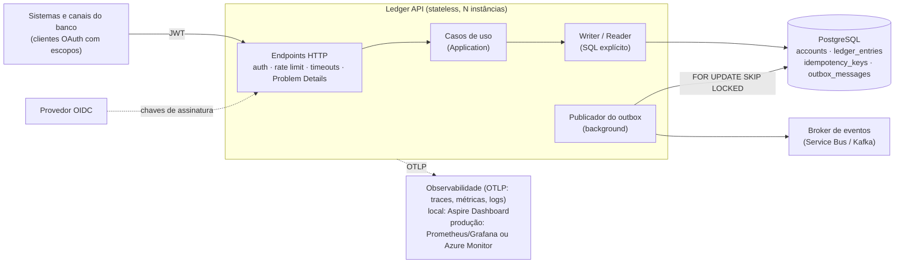
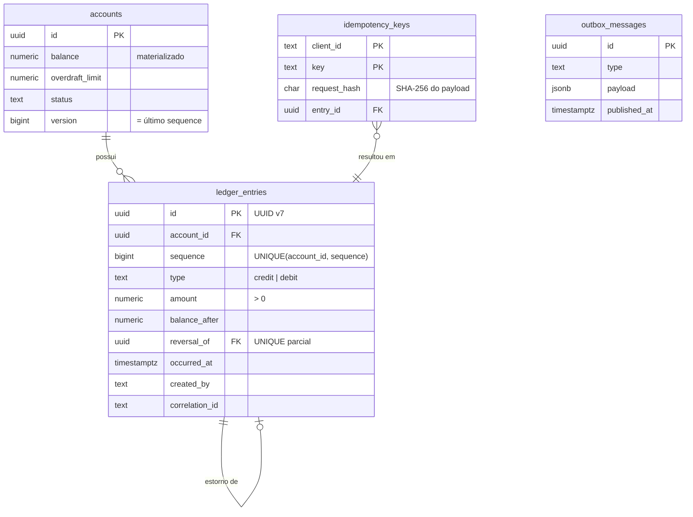
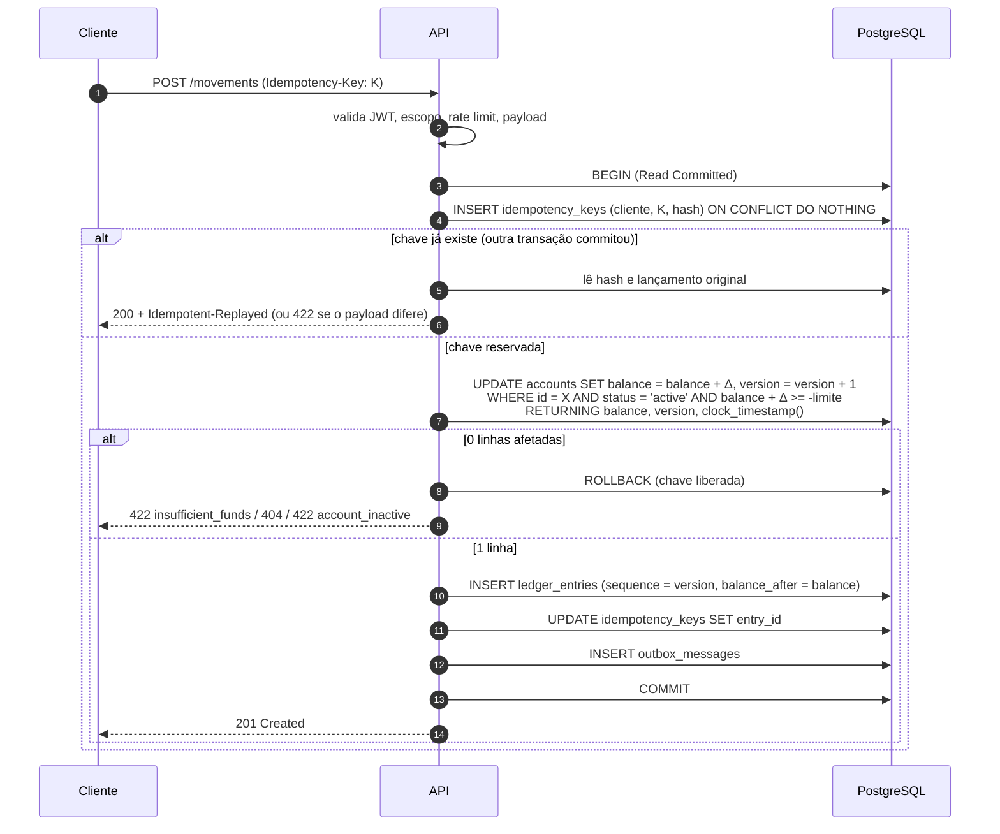

# Arquitetura

## 1. Problema e requisitos de qualidade

O sistema registra movimentações financeiras (créditos e débitos) e responde a posição consolidada de uma conta em qualquer instante. Em ordem de prioridade:

1. **Correção.** Nenhum lançamento perdido ou duplicado; saldo sempre coerente com o histórico; nunca abaixo do limite permitido. Perder alguns segundos de disponibilidade é aceitável; perder consistência não é.
2. **Auditabilidade.** Todo saldo pode ser explicado pelos lançamentos que o produziram. Nada é apagado ou editado.
3. **Comportamento previsível sob pico e falha.** Sobrecarga e falhas parciais geram respostas rápidas e acionáveis (429/503 com `Retry-After`), não lentidão generalizada nem estado incerto.
4. **Manutenibilidade.** Poucas peças, garantias explícitas e testáveis.

## 2. Visão geral

**Um serviço, um banco.** O problema tem um único contexto delimitado com exigência de consistência forte. Separar escrita e leitura em serviços distintos, ou introduzir um broker no caminho da escrita, trocaria consistência forte por consistência eventual exatamente onde ela não é aceitável ([ADR 0001](adr/0001-monolito-modular.md)). A API é stateless: escala horizontalmente atrás de um balanceador, e o banco é o único ponto de coordenação.

### Camadas

| Projeto | Responsabilidade | Depende de |
|---|---|---|
| `Ledger.Domain` | Tipos e regras do negócio: `Money`, `Movement`, `LedgerEntry`, erros | — |
| `Ledger.Application` | Casos de uso, validação de entrada, portas `ILedgerWriter`/`ILedgerReader` | Domain |
| `Ledger.Infrastructure` | Implementação PostgreSQL das portas, migrations, retry, outbox | Application |
| `Ledger.Api` | HTTP, autenticação, autorização, rate limiting, observabilidade | Infrastructure |

As invariantes que dependem de concorrência (saldo, ordem, idempotência) **não** são verificadas no domínio em memória: só podem ser garantidas atomicamente onde o estado vive, no banco. O domínio cuida das regras que não dependem de estado compartilhado (valor válido, tipo, descrição).

## 3. Modelo de dados

Garantias aplicadas **pelo banco** (um bug na aplicação não consegue violá-las):

| Garantia | Mecanismo |
|---|---|
| Lançamentos imutáveis | Triggers rejeitam `UPDATE`, `DELETE` e `TRUNCATE` em `ledger_entries` |
| Saldo nunca abaixo do limite | `CHECK (balance >= -overdraft_limit)` |
| Ordem total por conta, sem duplicidade | `UNIQUE (account_id, sequence)` |
| Um estorno por lançamento | Índice único parcial em `reversal_of` |
| Idempotência | `PRIMARY KEY (client_id, key)` |
| Valores válidos | `CHECK (amount > 0)`, `numeric(19,2)`, tipos e status enumerados |

## 4. Fluxo de escrita

Pontos centrais:

- **Não existe "ler saldo → decidir → gravar".** A regra de saldo é avaliada pelo próprio `UPDATE`, sob o lock da linha. Duas transações na mesma conta são serializadas pelo lock; contas diferentes não competem ([ADR 0004](adr/0004-concorrencia-update-condicional.md)).
- **Duplicatas concorrentes esperam no índice único.** Se duas requisições com a mesma chave chegam juntas, a segunda bloqueia no `INSERT` da chave até a primeira terminar e então faz replay ([ADR 0005](adr/0005-idempotencia.md)).
- **Tudo ou nada.** Lançamento, saldo, chave e evento são confirmados no mesmo `COMMIT`.
- **`sequence` é a fonte de verdade da ordem.** `occurred_at` é lido com `clock_timestamp()` depois de obtido o lock, então acompanha `sequence` dentro da conta.

## 5. Fluxo de leitura e modelo de consistência

| Consulta | Fonte | Custo | Consistência |
|---|---|---|---|
| Saldo atual | `accounts.balance` | 1 leitura por PK | Forte (reflete todo commit) |
| Saldo em T | último `ledger_entries` com `occurred_at <= T` (`balance_after`) | 1 busca no índice `(account_id, occurred_at DESC, sequence DESC)` | Forte para T no passado |
| Extrato | `ledger_entries` por `sequence` (keyset) | proporcional ao tamanho da página | Forte |

Nenhuma consulta soma lançamentos, então o custo não cresce com o histórico da conta.

**Nuance de "saldo em T" para T muito recente:** um lançamento recebe `occurred_at` antes de seu `COMMIT`. Uma consulta com T nos últimos milissegundos pode, portanto, ainda não enxergar um lançamento que está commitando com `occurred_at <= T`. A janela é limitada pela duração da transação (milissegundos, com teto em `statement_timeout`). Para T além dessa janela, a resposta é estável e nunca muda ([ADR 0006](adr/0006-consultas-de-saldo.md)).

## 6. Comportamento sob carga

- **Escala horizontal da API:** stateless; qualquer instância atende qualquer requisição.
- **Rate limiting por cliente** (token bucket, sem fila): um cliente ruidoso recebe 429 e não degrada os demais.
- **Timeouts em todas as camadas:** `lock_timeout` (espera por conta disputada), `statement_timeout` (comando), timeout de requisição HTTP. Nenhuma requisição prende conexão indefinidamente.
- **Falha rápida:** indisponibilidade do banco vira 503 com `Retry-After`, e o retry com a mesma chave é seguro.
- **Gargalo conhecido:** o throughput de escrita **por conta** é limitado pela serialização no lock da linha (centenas a poucos milhares de operações por segundo por conta, dependendo do hardware). Isso é intrínseco a uma conta com saldo único e consistente; a evolução para contas extremamente quentes está no README.

Detalhes por cenário em [failure-modes.md](failure-modes.md).

## 7. Segurança

- **Autenticação** JWT (OIDC em produção), **autorização** por escopos (`ledger:read`, `ledger:write`), menor privilégio.
- **O ledger não armazena PII.** Conhece apenas identificadores de conta; nome, CPF e afins pertencem a outro contexto. Eventos publicados não incluem a descrição livre.
- **Erros não vazam detalhes internos**: o corpo traz `code` e `traceId`; exceções vão apenas para o log.
- **Configuração insegura impede a subida:** fora de Development/Testing, sem `Auth:Authority` a aplicação não inicia.

Ver [ADR 0008](adr/0008-seguranca.md).

## 8. Observabilidade

> **Observabilidade técnica fica com OpenTelemetry exportando via OTLP; localmente para o Aspire Dashboard, em produção para Prometheus/Grafana ou Azure Monitor sem mudar código.**

A API emite traces (ASP.NET Core + Npgsql), métricas e logs estruturados, e exporta via OTLP quando `OTEL_EXPORTER_OTLP_ENDPOINT` está definido. O destino é configuração: a aplicação não conhece nenhum backend. Métricas de negócio:

| Métrica | Uso |
|---|---|
| `ledger.entries.recorded` (por tipo, estorno) | Volume |
| `ledger.writes.rejected` (por `code`) | Saldo insuficiente, validação, chave reutilizada |
| `ledger.idempotent.replays` | Sinal de retries de clientes (rede instável, timeouts) |

O `correlation_id` gravado em cada lançamento é o trace id da requisição, ligando o registro contábil ao trace distribuído.

Spans do Npgsql só são gerados dentro de um trace existente: o polling do outbox, que roda sem trace pai, não polui a visão com um trace por segundo.

| Ambiente | Destino OTLP | Por quê |
|---|---|---|
| Local | .NET Aspire Dashboard standalone (profile `observability` do docker-compose) | Um único container, sem configuração, cobrindo os três sinais. Sem persistência nem alertas, o que é aceitável para desenvolvimento e avaliação. Escolhido em vez de Prometheus + Grafana, que exigiria dois containers e configuração extra. |
| Produção | OpenTelemetry Collector → Prometheus/Grafana (com Tempo/Loki) ou Azure Monitor | Persistência, retenção, dashboards e alertas. A troca é apontar `OTEL_EXPORTER_OTLP_ENDPOINT` para o collector, sem mudança de código. |
